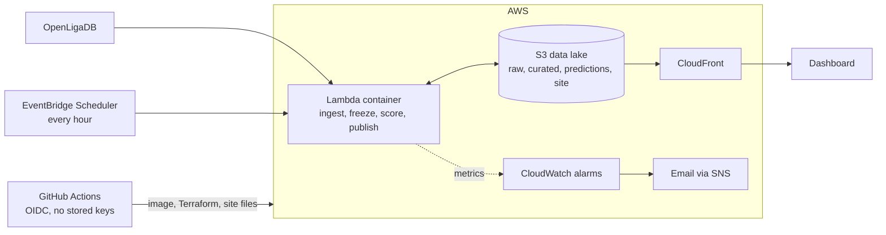

# Spieltag

A self-evaluating Bundesliga forecasting pipeline on AWS. Every hour it fetches the latest fixtures
and results, writes a win-draw-loss forecast for each match 24 hours before kickoff, locks that
forecast so it can never be edited, and grades it against the real result after the final whistle.
A public dashboard shows the live track record next to a walk-forward backtest.

The point of the project is the honesty of the evaluation, not the sophistication of the model.
A forecast only means something if it was made before the result was known, so the pipeline is built
to make that provable.

**Status: v1 complete.** Ingestion, three models, walk-forward evaluation, the scheduled pipeline,
frozen forecasts, live scoring, the dashboard, alarms and the deploy workflow are all in this repository.

Data: results and fixtures come from [OpenLigaDB](https://www.openligadb.de), licensed under the ODbL.

## How it fits together



Each hour the Lambda function does four things, in this order (`src/spieltag/cycle.py`):

1. **Ingest** the current season. If the API is down or the data breaks its contract, the run carries
   on with the data already stored, and the failure is reported instead of hidden.
2. **Freeze** a forecast for every match that is within 24 hours of kickoff and has none yet.
3. **Score** every frozen forecast whose match has finished.
4. **Publish** four small JSON files that the static dashboard reads.

## How the self-evaluation works

A frozen forecast is one JSON file per match (`predictions/league=bl1/season=2026/match_id=....json`):

```json
{
  "match_id": 2020001, "kickoff_utc": "2020-08-14T18:00:00Z",
  "as_of_utc": "2020-08-13T18:00:00Z", "frozen_at_utc": "2020-08-14T00:00:00Z",
  "models": { "elo_ordered_logit": {"p_home": 0.408, "p_draw": 0.271, "p_away": 0.321}, "...": "..." },
  "features": { "elo_diff": 7.2, "form_home": 2.0, "rest_days_home": 14.0, "...": "..." },
  "training": { "trained_until": "2020-08-13T18:00:00Z", "matches": 1224, "data_fingerprint": "b2409ac6d293" },
  "code_version": "3f9c1e0a77b2",
  "fingerprint": "a4f2bf8f..."
}
```

What makes it trustworthy:

- **Written once.** Every write uses an S3 conditional write (`If-None-Match: *`), so a second write for
  the same match is refused, even if two runs overlap. The bucket policy goes further: it denies every
  write under `predictions/` that is not conditional, and denies deletes there. Nobody can replace a
  forecast, the pipeline included, without first changing the bucket policy, which shows up in the logs.
- **Tamper evident.** Each record carries a SHA-256 fingerprint of its own content. A record that
  fails the check is excluded from scoring, reported on the dashboard and raises an alarm.
- **Only what was known.** Features are rebuilt as of 24 hours before kickoff, and the models are
  trained on results that were final at that moment. A result counts as known 3 hours after kickoff.
- **Never after kickoff.** The pipeline only freezes matches whose kickoff is still in the future. If
  a run is missed, the match is reported as missed, an alarm fires and nothing is backfilled. A match
  that kicked off before the pipeline first ran is never counted.
- **Same code as the backtest.** A replay test (`tests/test_cycle.py`) runs a simulated season hour by
  hour through the real parser, contracts and storage layer, and checks that every live forecast equals
  what the walk-forward backtest says it would have been, to nine decimal places. The two paths cut their
  training data with one shared function. The tests also break the code on purpose (freeze after kickoff,
  allow overwrites, train on newer results) and confirm that they fail.

The honest limit: live and backtest agree exactly only if the data arrives on time. If OpenLigaDB
publishes a result late, the live features lack it while the backtest assumes it was known after three
hours. The record keeps a fingerprint of the exact training data, so such a difference can be traced.

## The live line (in-play estimate)

Under each sealed forecast the dashboard shows a second line that updates every five minutes while the
match is played. It is a different thing from the sealed forecast and is kept apart from it: stored under
`inplay/`, never written to `predictions/`, and scored on its own.

**The model.** A Poisson goal process. The sealed home, draw and away probabilities are turned into the
expected goals of each team over 90 minutes (`fit_rates`). Each minute carries a share of those goals
(45 percent in the first half by default). The chance of every number of further goals is then added to the
current score, which gives home, draw and away probabilities for the final result. At minute 0 and 0:0 it
reproduces the sealed forecast exactly. Nothing is trained on the match itself.

**What it uses.** The score, an estimate of the match minute, and the sealed forecast. OpenLigaDB lists each
goal with its minute and the running score, but it has no clock, no cards, no substitutions and no
injuries. The minute is estimated from the kickoff time (45 minutes, a 15 minute break, 45 minutes), so it can
be a few minutes off, and goals can appear a minute or more late. Red cards are not used, and the dashboard says so.

**Game state.** Teams that trail may attack more and teams that lead may defend. `StateFactors` multiplies a
team's scoring rate by a factor for trailing by 1, trailing by 2 or more, leading by 1 and leading by 2 or
more. The default is 1 everywhere. `spieltag-inplay-fit` estimates the factors by counting goals in 5-minute
slices on past seasons, shrinks the ones that rest on few goals towards 1, and tests them on the latest
seasons it did not fit. With `--write` it stores them only if they clearly beat the neutral model on those
held-out seasons. Until then the live job runs neutral.

```bash
spieltag-evaluate --bucket my-lake                     # writes the walk-forward predictions it needs
spieltag-inplay-fit --bucket my-lake                   # report only
spieltag-inplay-fit --bucket my-lake --write           # store the parameters if they win held-out
```

**Scoring the live line.** For every finished match the stored estimates at minutes 15, 30, 45, 60 and 75
are scored (ranked probability score and Brier score) against the sealed forecast and published as a table
with a 95 percent interval. A live line that uses the score must beat the sealed one by more the later the
minute. If it does not, something is wrong.

**Running it.** `aws_scheduler_schedule.inplay` invokes the same Lambda every five minutes with
`{"task": "inplay"}`. A tick returns at once unless a sealed match has kicked off in the last four and a half
hours. It reads the sealed records and never writes them. Set `inplay_enabled = false` in `infra/main` to switch
the schedule off without touching anything else. The alarm `spieltag-inplay-feed-failing` fires if the match
feed fails for 15 minutes while a match is on.

What has been checked: the tick logic, the maths and the estimator on simulated matches (the planted
state effect is recovered and the probabilities are calibrated), and the page in a browser. What has not been
checked: the model on real Bundesliga goal times. Run `spieltag-inplay-fit` for that, and read its held-out table.

## Evaluate the models

```bash
# after ingesting 2016 to 2026 (see "Run it locally"), locally or with --bucket
spieltag-evaluate --first-season 2016 --out data
```

It replays history matchday by matchday, refits the three models before each one, scores every
prediction and writes `evaluation/bl1/report.md`, `report.json` and `predictions.parquet` next to the
data. The report holds the leaderboard, the score per season, paired comparisons with 95% intervals,
and a calibration table. The pipeline publishes `report.json` as the dashboard's backtest panel.

### Results

Run on 7 October 2026. Seasons 2016 to 2026 were ingested and 2018 to 2026 were predicted: 2,484
finished matches, of which only 36 come from the 2026 season that is still running. Lower is better.

| Model | Matches | RPS | Log loss | Brier | Accuracy | RPS skill vs climatology |
| --- | ---: | ---: | ---: | ---: | ---: | ---: |
| elo_ordered_logit | 2484 | 0.2048 | 0.9959 | 0.5941 | 51.2% | +11.7% |
| feature_logit | 2484 | 0.2050 | 0.9964 | 0.5947 | 51.9% | +11.6% |
| climatology | 2484 | 0.2320 | 1.0730 | 0.6494 | 43.6% | - |

- **Both models beat the baseline.** The Elo model lowers the ranked probability score by 0.027
  (95% interval 0.022 to 0.032), and it beats climatology in every one of the nine seasons.
- **The simple model is as good as the rich one.** Elo alone against Elo plus form, goal margin and rest
  days: a difference of 0.0002 with a 95% interval from -0.0013 to +0.0009. The data cannot tell them
  apart, so the extra features add nothing measurable on top of the rating.
- **Calibration is close for most of the range, with one weak spot.** Forecast and observed home-win
  rates agree within a few points in most bands. For strong favourites (forecast 80 to 90 percent) the
  home side won 68 percent of 62 matches, about three standard errors below the forecast. That is a
  small sample, so it is a lead for v2 and not a conclusion. Any fix has to be judged by the same
  walk-forward evaluation.
- **No bookmaker benchmark yet.** Bookmaker odds are the standard yardstick and are not in this
  comparison. Until v2 adds them, this project makes no claim about matching bookmakers.
- **Season rows vary** (0.195 to 0.213 for Elo), which is ordinary luck over 306 matches. The 2026 row
  covers 36 matches and should not be read at all.

### Why the backtest can be trusted

- **Point in time.** The features of a match use only results that were known 24 hours before its
  own kickoff, which is when the pipeline freezes its forecasts. Rest days come from the public schedule.
- **Walk forward.** Before every matchday the models are fitted only on results known 24 hours
  before that matchday's first kickoff. No model ever sees the matchday it predicts, let alone later ones.
- **Headline score.** Ranked probability score (lower is better), the standard for ordered football
  outcomes, next to log loss, Brier score and calibration. Every model is compared with climatology
  (how often home wins, draws and away wins happen), so skill is measured against something real.
- **No tuning.** Elo constants and model settings are fixed defaults. Tuning them on the same matches
  would flatter the result.
- **Tested for leakage.** `tests/test_features.py` changes results that were not yet known and checks
  that no earlier row moves, and that a match's own result never reaches its own features. A further
  test deliberately breaks the feature builder and checks that the leakage test notices.
  `tests/test_evaluate.py` runs the whole evaluation on a simulated league with no signal: if
  anything leaked, a model would beat the league averages there, and the test would fail.

Differences between models are reported with a 95% interval. If it contains zero, the data cannot
tell the two models apart, and the dashboard says so. The live record needs 30 graded matches before
it gives a first verdict, and it will take a few matchdays to get there.

## Run it locally

```bash
python -m venv .venv && source .venv/bin/activate     # on Windows: .venv\Scripts\Activate.ps1
pip install -e ".[dev]"
pytest

spieltag-ingest --season 2025                          # one season into ./data
spieltag-run --backfill --first-season 2016            # all seasons, then one full cycle
```

`spieltag-run` runs exactly what the Lambda runs, against a local folder (or `--bucket`). To see the
dashboard on your machine, copy the static files next to the data the cycle wrote and serve them:

```bash
mkdir -p data/site && cp -r site/. data/site/ && python -m http.server -d data/site 8000
```

`spieltag-run --now 2026-10-09T12:00:00Z` pretends it is that time, for replays and demos. The Lambda
never accepts a time override.

If ingest validation fails, the raw answer is still saved under `data/raw/`, nothing curated changes and
`spieltag-ingest` exits with code 2. A problem reaching the API exits with code 3.

## Deploy

You need an AWS account, the AWS CLI, Terraform 1.11 or newer, and a GitHub repository.

**Do not use root access keys.** Create an admin user in IAM with MFA, sign in with `aws configure`
and check `aws sts get-caller-identity` before you start.

```bash
# 1. Bootstrap, once, with local state: state bucket, GitHub OIDC roles, budget alert
cd infra/bootstrap
cp terraform.tfvars.example terraform.tfvars    # set github_owner, github_repo, alert_email and, for repos created after 15 July 2026, github_owner_id and github_repo_id
terraform init && terraform apply
cd ../..

# 2. Create just the data lake bucket, so there is somewhere to load history into.
#    (The deploy workflow creates everything else, including the image registry.)
terraform -chdir=infra/main init \
  -backend-config="bucket=$(terraform -chdir=infra/bootstrap output -raw state_bucket)" \
  -backend-config="region=eu-central-1"
terraform -chdir=infra/main apply -target=aws_s3_bucket.lake \
  -var alert_email=you@example.com -var image_tag=bootstrap

# 3. Load history into the lake (about a minute)
spieltag-ingest --season 2016 --bucket spieltag-lake-<account id>      # and so on to the current season
spieltag-evaluate --bucket spieltag-lake-<account id>                  # the backtest the dashboard shows
```

Then, in the GitHub repository settings under *Secrets and variables, Actions, Variables*, add three
repository **variables** (not secrets): `AWS_DEPLOY_ROLE_ARN` and `AWS_PLAN_ROLE_ARN` from the
bootstrap outputs, and `ALERT_EMAIL`.

From then on, every push to `main` runs `.github/workflows/deploy.yml`:

1. ruff and pytest must pass,
2. the image registry is created if it is missing, then the pipeline image is built and pushed to it, tagged with the commit hash,
3. `terraform apply` creates or updates the Lambda, the schedule, CloudFront and the alarms,
4. the dashboard files are copied to S3 and the CloudFront cache is cleared,
5. the pipeline runs once and the workflow fails if it errors or if the dashboard does not answer.

Pull requests that touch `infra/` get a read-only `terraform plan` in their job summary.

The first deploy ends with the dashboard URL in the job summary. AWS also emails a subscription
confirmation to `ALERT_EMAIL`. Click it, or the alarms cannot reach you.

The dashboard needs no database or server. It is static files plus five JSON files under `site/data/`.
Four are rewritten every hour, and `inplay.json` every five minutes while a match is on.

## Operating it

| Alarm | What it means | What to do |
| --- | --- | --- |
| `spieltag-function-errors` | The function crashed or could not write forecasts. | Open the log group `/aws/lambda/spieltag-pipeline` and look for `cycle_crashed` or `freeze_failed`. |
| `spieltag-no-recent-run` | No completed run for three hours. | Check that the schedule is enabled and the function is not failing. Check the account's billing status. |
| `spieltag-missed-forecast` | A match kicked off without a frozen forecast. | It cannot be fixed afterwards, by design. Find the cause (usually an earlier outage). The alarm clears after three days. `status.json` keeps the lifetime count in `missed_total`. |
| `spieltag-ingest-failing` | Fetching or validating match data failed for six hours. | Forecasts continue from stored data. Look for `ingest_failed` in the logs. If OpenLigaDB changed its format, fix `ingest.py` and its test fixture together. |
| `spieltag-inplay-feed-failing` | The live match feed failed for 15 minutes during a match. | Only the live line is stale; sealed forecasts are unaffected. Look for `inplay_feed_failed` in the logs. |
| `spieltag-problem-records` | A frozen forecast failed its fingerprint check, or the data has a gap. | Read `problems` in `status.json`. Treat a fingerprint failure as a serious event. |

The dashboard shows the same health state at the top. It turns amber when something needs attention
and red when the data is more than three hours old.

## Cost and safety

- Expected running cost is well under 1 USD a month: one short Lambda run an hour, a few megabytes in
  S3, a small container image, a handful of alarms. The budget alert exists to catch the case where
  that is wrong. It emails you at 80 percent of the actual monthly limit and at 100 percent of the
  forecast, and it ignores credits on purpose, so it still fires while credits pay the bill.
- If your account is on the AWS Free plan, upgrade to the Paid plan before the plan ends, otherwise the
  account closes with everything in it. The Billing console shows the date.
- `terraform destroy` in `infra/main` removes the stack. The bucket policy denies deleting forecasts,
  so to destroy the lake you must remove that statement first. That is intended.

### Known limits of the deploy role

The deploy role can only touch resources named `spieltag-...`, with three exceptions that AWS cannot
limit by name:

- **CloudFront** actions apply to all distributions in the account.
- **Inline IAM policies** on roles named `spieltag-app-...` can be written freely, so the role could
  grant itself more permissions than it needs. Tighten this with a permissions boundary before you make
  the repository public or add collaborators.
- **ReadOnlyAccess** is attached to both roles so Terraform can refresh state. It can read most of the account.

## What v1 does not do

- **The live line knows only the score and the clock.** No cards, substitutions, injuries, possession or
  shots. A paid event feed would be needed, and its history, to learn what they are worth.
- **No bookmaker benchmark.** Without odds, nothing here says how the models compare with the market.
- **Few live matches at first.** The live record starts on the day of the first deploy. Until 30
  matches are graded, the dashboard says it is too early to call.
- **Simple models.** Elo with an ordered logit, and a regularised logistic regression on form and rest.
  Dixon-Coles, gradient boosting and a calibration layer are the next candidates, each judged by the
  same walk-forward evaluation.
- **One league, one data source.** If OpenLigaDB changes or disappears, the ingest step fails loudly.

## Layout

```
infra/bootstrap/   state bucket, GitHub OIDC roles, budget alert
infra/main/        main.tf   ECR, data lake bucket and its policy
                   app.tf    Lambda function, its role, the hourly and five-minute schedules
                   site.tf   CloudFront with origin access control and security headers
                   alarms.tf SNS topic and the six alarms
src/spieltag/      ingest.py, contracts.py, store.py, pipeline.py        ingest
                   ratings.py, features.py, models.py, metrics.py        modelling
                   evaluate.py, evaluate_cli.py                          backtest
                   frozen.py, live.py, cycle.py, handler.py, run_cli.py  production
                   inplay.py, inplay_fit.py, inplay_fit_cli.py           live line
site/              the dashboard: index.html, style.css, app.js, one self-hosted font
tests/             pytest tests, a simulated league and a simulated clock for replays
.github/workflows/ ci.yml, deploy.yml, plan.yml
Dockerfile         the Lambda image, dependencies pinned in constraints.txt
```

The dashboard font is Archivo (SIL Open Font License, `site/fonts/OFL.txt`), served from the same
origin so visitors make no requests to third parties.
